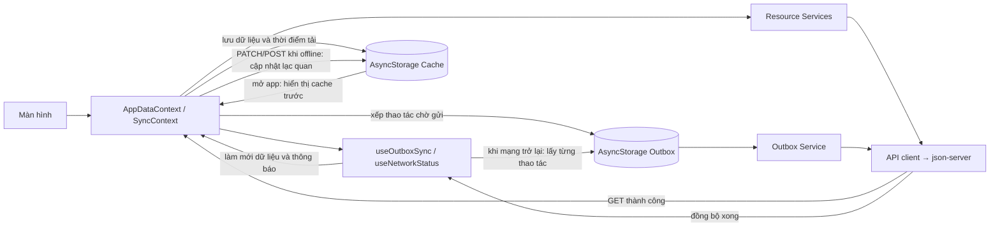

# Ứng dụng Quản lý học tập — API & Offline

Dự án dùng **React Native CLI**, TypeScript, React Navigation, AsyncStorage, NetInfo và `json-server`; không dùng Expo. Thư mục dự án: `quanlyapp`.

## Yêu cầu môi trường

- Node.js `>= 22.11.0` và npm.
- Android Studio, Android SDK, JDK tương thích React Native `0.87.1`, cùng emulator hoặc thiết bị Android.
- Emulator/điện thoại và máy tính chạy `json-server` phải truy cập được cùng API. Emulator Android tiêu chuẩn tự dùng `10.0.2.2`; thiết bị thật cần IP LAN của máy tính.

## Cài đặt và chạy Android

Mở PowerShell tại thư mục gốc `quanlyapp`. Cài dependencies lần đầu (hoặc sau khi thay đổi dependency):

```powershell
npm install
```

### 1. Chạy REST API mẫu

Mở terminal thứ nhất:

```powershell
npm run server:delay
```

Lệnh này chạy `json-server` trên cổng `3000`, lắng nghe trên mọi giao diện mạng và thêm độ trễ `800ms` để có thể quan sát trạng thái tải. Dữ liệu ban đầu nằm trong `db.json`; các collection là `students`, `courses`, `sessions`, `assignments`, `grades`.

Kiểm tra API trên máy tính:

```powershell
Invoke-RestMethod http://127.0.0.1:3000/courses
```

`src/config.ts` chứa URL API. Android emulator tiêu chuẩn được nhận diện và dùng `http://10.0.2.2:3000`; máy khác dùng địa chỉ LAN khai báo trong `BASE_URL`. Nếu IP LAN thay đổi, cập nhật giá trị này, bảo đảm firewall cho phép cổng `3000`, rồi đóng/mở lại Metro để nạp cấu hình mới. Tìm IPv4 LAN bằng:

```powershell
ipconfig
```

### 2. Chạy Metro

Mở terminal thứ hai tại thư mục dự án:

```powershell
npm start
```

### 3. Cài và mở app trên emulator Android

Mở terminal thứ ba:

```powershell
adb devices
adb reverse tcp:8081 tcp:8081
npm run android
```

`adb reverse` chuyển Metro qua USB/emulator. Với thiết bị thật, bật USB debugging và xác nhận thiết bị xuất hiện trong `adb devices`; điện thoại cũng phải truy cập được IP LAN và cổng `3000` trên máy tính.

### Chạy app có bundle để kiểm thử khởi động offline

Bản debug cần Metro để tải JavaScript bundle. Để kiểm tra **tắt mạng rồi khởi động lại ứng dụng**, hãy build/cài bản release có bundle đóng gói sẵn:

```powershell
Set-Location android
.\gradlew.bat assembleRelease
Set-Location ..
adb install -r android\app\build\outputs\apk\release\app-release.apk
```

App vẫn cần `json-server` để lấy dữ liệu mới khi online; bản release chỉ loại bỏ phụ thuộc Metro lúc khởi động.

## Luồng dữ liệu và offline



- Màn hình đọc/cập nhật dữ liệu qua Context; `useNetworkStatus` theo dõi mạng và `useOutboxSync` quản lý hàng đợi, trạng thái đồng bộ. Các service gọi API; cache và Outbox là các helper AsyncStorage riêng, không được thao tác trực tiếp trong UI.
- Khi mở app, dữ liệu đã cache được nạp để hiển thị ngay; khi online, ứng dụng gọi API và cập nhật cache. Màn hình danh sách có trạng thái tải, lỗi/thử lại, rỗng và kéo để làm mới.
- Khi offline, thay đổi trạng thái bài tập, hồ sơ và bài tập mới được thể hiện lạc quan trên giao diện, ghi vào cache và đưa vào Outbox. Các mục còn chờ có nhãn **“Chưa đồng bộ”**. Khi mạng trở lại, Outbox gửi lần lượt; thành công thì xóa thao tác khỏi hàng đợi và làm mới dữ liệu.
- Với PATCH, ứng dụng đọc bản ghi server trước khi gửi. Nếu `server.updatedAt` mới hơn thời điểm thao tác offline (`operation.updatedAt`), bỏ qua PATCH và giữ dữ liệu server; nếu không, áp dụng PATCH offline. Sau lượt đồng bộ, dữ liệu được tải lại từ server. Banner hiện số thay đổi đã đồng bộ; hiện chưa có thông báo riêng mô tả một thao tác bị bỏ qua do xung đột.
